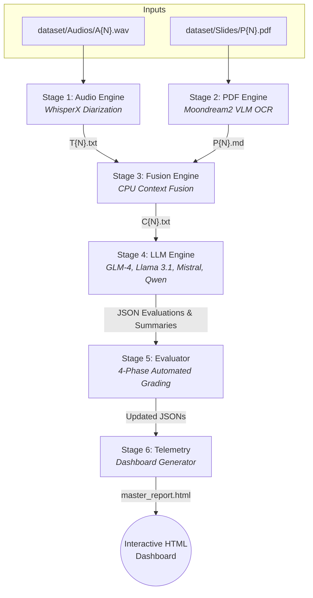

# Multimodal Summarization Benchmarking Pipeline

A highly optimized, 6-stage pipeline built to run on a 40GB A100 GPU. It processes audio recordings and presentation slides to benchmark the summarization capabilities of leading Large Language Models (LLMs) using an automated, multi-phase evaluation system.

## 🌟 Features

*   **VRAM Discipline:** Implements strict sequential loading and full memory annihilation (Python GC + CUDA cache clearing) to successfully fit heavy models and long contexts within a strict 40GB VRAM budget.
*   **Multimodal Processing:** Seamlessly transcribes audio with speaker diarization using WhisperX, and extracts structured slide text and tables using the Moondream2 Vision-Language Model.
*   **Advanced Evaluation:** Features a robust four-phase automated grading suite:
    *   Lexical overlap (ROUGE-L)
    *   Semantic similarity (BERTScore)
    *   Factual consistency/Hallucination checks (NLI Cross-Encoders)
    *   LLM-as-a-Judge (Meta-Llama-3.1-8B-Instruct)
*   **Hardware Telemetry:** Runs a background daemon to track real-time peak VRAM usage and calculates precise token throughput (tok/s) for efficiency benchmarking.
*   **Interactive Reporting:** Automatically compiles all evaluation JSONs into a world-class, interactive HTML dashboard powered by Plotly.js and Tailwind CSS.

## 🔄 Pipeline Architecture

The pipeline runs completely autonomously, dynamically discovering datasets and pushing them through six sequential stages where the output of one phase becomes the input for the next.



## 📁 Directory Structure

The project dynamically generates its required directories, organizing raw inputs and pipeline artifacts cleanly.

```text
.
├── dataset/                  # Drop raw inputs here
│   ├── Audios/               # A1.wav, A2.wav...
│   ├── Slides/               # P1.pdf, P2.pdf...
│   └── Summaries/            # S1.txt, S2.txt... (Ground truth references)
├── outputs/                  # Auto-generated pipeline artifacts
│   ├── contexts/             # Fused multimodal contexts (C{N}.txt)
│   ├── evaluations/          # Raw metric/telemetry data (R{N}_model.json)
│   ├── gen_summaries/        # Standalone generated LLM summaries (.md)
│   ├── ocr/                  # VLM extracted slide text (P{N}.md)
│   └── transcripts/          # Diarized audio transcripts (T{N}.txt)
├── main.py                   # Master orchestrator script
├── config.py                 # Centralized paths, models, and prompts
├── audio_engine.py           # Stage 1
├── pdf_engine.py             # Stage 2
├── fusion_engine.py          # Stage 3
├── llm_engine.py             # Stage 4
├── evaluator.py              # Stage 5
└── telemetry.py              # Stage 6 & Hardware tracking
```

## 🚀 Quick Start

1. **Clone the repository:**
   ```bash
   git clone <your-repo-url>
   cd <your-repo-name>
   ```

2. **Install dependencies:**
   Ensure you are using a Python environment with PyTorch configured for CUDA.
   ```bash
   pip install -r requirements.txt
   ```

3. **Configure Environment:**
   Create a `.env` file in the root directory and add your Hugging Face token (required for Pyannote Diarization).
   ```env
   HF_TOKEN=your_huggingface_token_here
   ```

4. **Run the Pipeline:**
   Place your perfectly named trios (`A1.wav`, `P1.pdf`, `S1.txt`) into the respective `dataset/` subfolders, then execute the master script:
   ```bash
   python main.py
   ```

Once complete, open `master_report.md` to view the benchmarked metrics.
